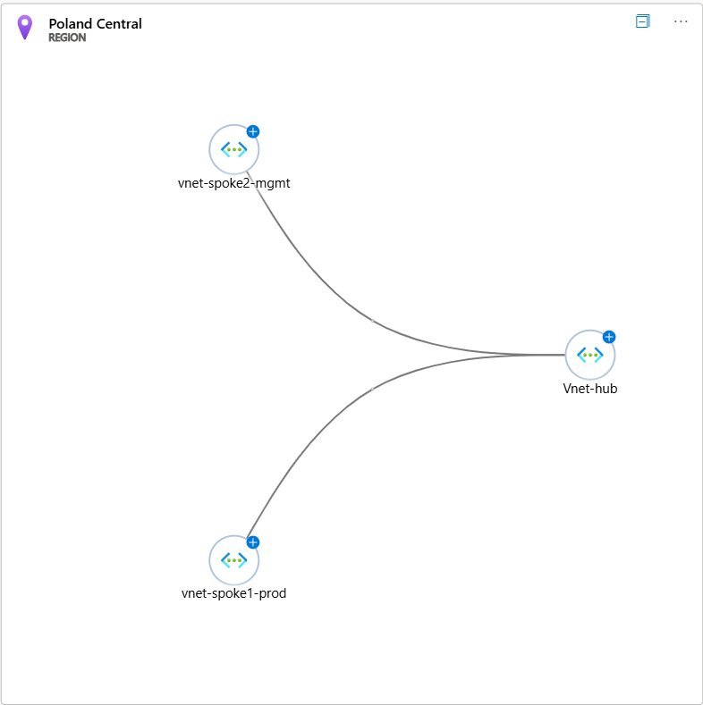
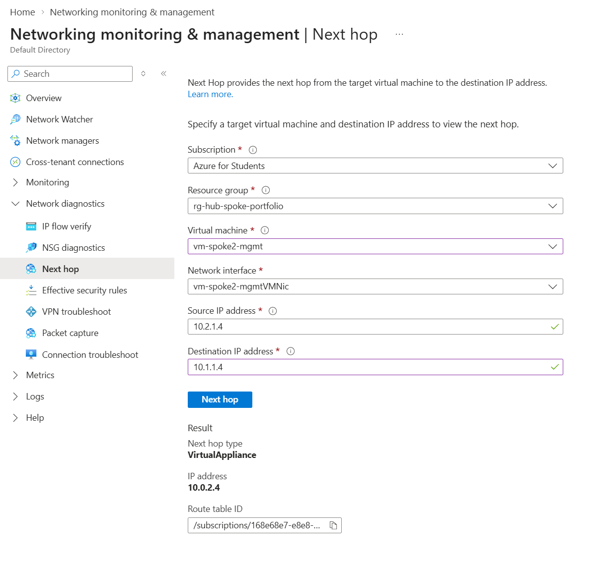
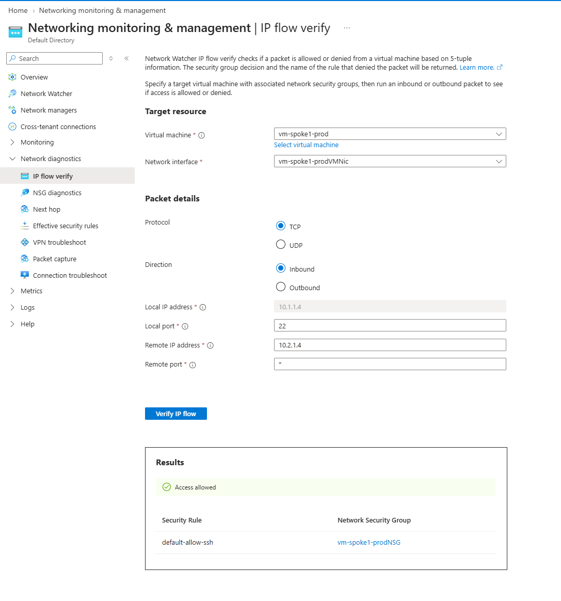
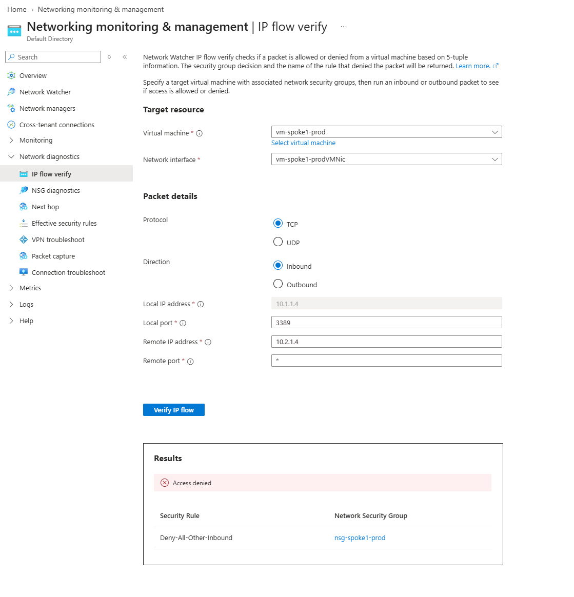

# Azure Secure Hub-and-Spoke Network Architecture

A hands-on implementation of an enterprise Hub-and-Spoke virtual network topology in Microsoft Azure, scripted with Azure CLI. 

I built this project to move beyond cloud theory and see firsthand how security teams isolate production environments, force traffic through a central inspection appliance, and enforce least-privilege access using Application Security Groups.

---

## The Problem and Architecture

In large cloud environments, you rarely want virtual networks talking to each other directly or having direct, unmonitored egress to the internet. 

Instead of a flat network, this architecture uses a central Hub to control and inspect traffic between two isolated Spoke environments:



### Network Layout:
* **Hub VNet (`10.0.0.0/16`)**: The transit and security hub.
  * `GatewaySubnet` (`10.0.1.0/24`): Dedicated subnet reserved for site-to-site VPN / ExpressRoute gateway traffic.
  * `nva-subnet` (`10.0.2.0/24`): Hosts a lightweight Linux Network Virtual Appliance (NVA / Firewall) at static private IP `10.0.2.4`.
* **Production Spoke (`10.1.0.0/16`)**:
  * `prod-web-subnet` (`10.1.1.0/24`): Dedicated to sensitive production workloads (`vm-spoke1-prod`).
* **Management Spoke (`10.2.0.0/16`)**:
  * `mgmt-subnet` (`10.2.1.0/24`): Hosts management jumpbox infrastructure (`vm-spoke2-mgmt`).

---

## How It Works (Routing and Security)

### 1. Breaking Default Routing with Custom UDRs
By default, Azure automatically routes traffic between peered VNets directly. To enforce centralized security, I created a custom Route Table (`rt-spoke-to-nva`) applied to both spoke subnets:
* Traffic from Spoke 1 to Spoke 2 (and vice versa) has a next-hop type of `VirtualAppliance` pointing directly to the Hub NVA (`10.0.2.4`).
* All default outbound traffic (`0.0.0.0/0`) is also forced through the NVA for inspection.

### 2. Micro-Segmentation using ASGs
Hardcoding IP addresses in firewall rules gets messy fast. To avoid brittle rules, I used Application Security Groups (ASGs):
* Grouped the production workload into `asg-prod-web` and management into `asg-mgmt-jumpbox`.
* Created an NSG rule on the production subnet that explicitly allows inbound SSH (Port 22) only if the traffic originates from `asg-mgmt-jumpbox`.
* Added a low-priority catch-all deny rule (`Deny-All-Other-Inbound`) to drop everything else.

---

## Testing and Verification

Rather than just hoping the routes worked, I used Azure Network Watcher to validate the packet paths and security policies:

### Test 1: Verifying the NVA Next Hop
I tested what happens when the management VM (`10.2.1.4`) tries to send a packet to the production VM (`10.1.1.4`). 

As shown below, Network Watcher confirmed the packet doesn't go straight to production—it is successfully intercepted and forwarded to the central NVA at `10.0.2.4`:



### Test 2: Testing Micro-Segmentation (SSH vs RDP)
Next, I simulated two different inbound connection attempts from the management jumpbox to production:

1. **Authorized Admin Access (Port 22 / SSH):** Evaluated and allowed by the `default-allow-ssh` rule matching the ASG tags.
2. **Unauthorized Port Access (Port 3389 / RDP):** Dropped immediately by the `Deny-All-Other-Inbound` rule.

| Source IP | Target IP | Port / Protocol | Expected Result | Actual Result | Rule Enforced |
| :--- | :--- | :--- | :--- | :--- | :--- |
| `10.2.1.4` (Mgmt) | `10.1.1.4` (Prod) | TCP / 22 (SSH) | Allow | Allowed | `default-allow-ssh` |
| `10.2.1.4` (Mgmt) | `10.1.1.4` (Prod) | TCP / 3389 (RDP)| Deny | Denied | `Deny-All-Other-Inbound` |

**Allowed SSH Traffic:**


**Blocked RDP Traffic:**


---

## Key Lessons and Gotchas

* **VNet Peering is non-transitive:** Spokes cannot talk to each other through the Hub out-of-the-box. The peerings require `--allow-forwarded-traffic` enabled on both ends, combined with explicit UDRs.
* **Two layers of IP Forwarding:** For a Linux VM to act as an NVA, enabling IP Forwarding on the Azure Virtual NIC isn't enough; you also have to enable IP forwarding inside the Linux kernel (`net.ipv4.ip_forward=1`), or the OS silently drops packets destined for other machines.

---

## How to Run

The entire architecture can be spun up in Azure Cloud Shell using the included script:

```bash
# Clone the repository
git clone [https://github.com/aka2005gamer/azure-secure-hub-spoke-network.git](https://github.com/aka2005gamer/azure-secure-hub-spoke-network.git)
cd azure-secure-hub-spoke-network

# Make executable and deploy
chmod +x deploy-hub-spoke.sh
./deploy-hub-spoke.sh
